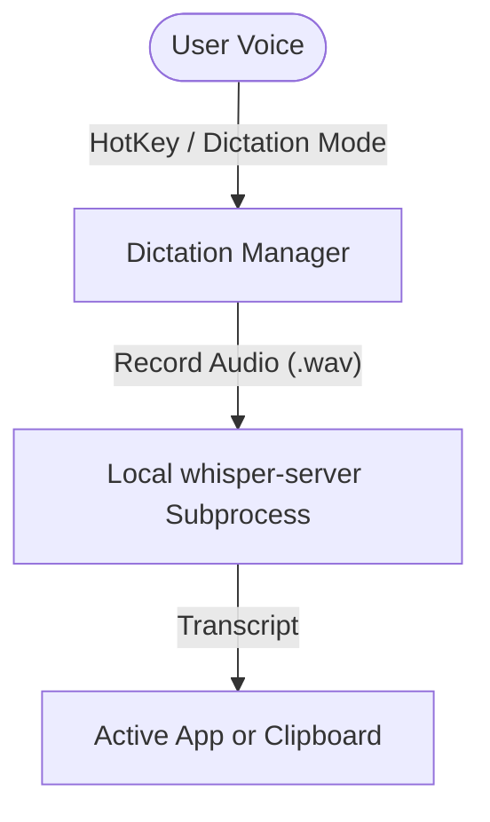

<p align="center">
  
</p>
<h1 align="center">Andy — AI Dictation Companion & DynamicIsland Workspace 🐶🤖</h1>

<p align="center">
  <a href="https://github.com/angdulu/andy-dynamic-island/stargazers">
    
  </a>
  <a href="https://github.com/angdulu/andy-dynamic-island/releases">
    
  </a>
</p>

## Project status: development paused

Active development is paused, with no further feature development currently planned. Dictation built into AI desktop apps now covers most of my everyday needs, so Andy is no longer a development priority for me.

I may still use Andy occasionally for personal or sensitive dictation, where keeping speech recognition on-device remains a valuable advantage. The existing source and releases remain available for that use.

---

**Andy** (formerly Atoll-Andy) is an advanced, customized macOS desktop pet and productivity assistant that lives directly in your MacBook notch or Dynamic Island. 

While preserving native system insight telemetry and media widgets, this fork integrates an **on-device Speech-to-Text (STT) Whisper transcriber** to turn voice dictations into text with zero cloud dependency.

---

## 🧠 Custom Architecture: Local AI Dictation Workspace

This fork introduces a **Dictation-Only Mode** and a local Whisper daemon binding for private on-device dictation:



### 1. The Speech-to-Text Daemon (`DictationManager.swift`)
- Integrates a precompiled **Whisper C/C++ server binary** (`whisper-server`) directly into the macOS application bundle.
- Manages recording state, playing custom sound cues (`whisper_begin.wav`, `whisper_end.wav`) to signify recording intervals.
- Records 16 kHz mono audio and sends the completed WAV to the local Whisper daemon when recording stops. Concurrent startup requests share one readiness check.
- Bundles whisper.cpp v1.9.5 with Metal acceleration and Silero voice activity detection. Whisper Turbo Q5 is available as a 574 MB multilingual model alongside the existing models.
- Models unload after ten minutes of inactivity by default; Settings also offers five minutes, thirty minutes, or always keeping them loaded.
- The most recent failed recording is retained locally for up to 24 hours with Retry and Discard actions. The last successful transcript can be copied from the menu bar or Settings.


---

## 🌟 Highlights & Original Features

- **Dictation-Only Mode:** Disables the optional island UI, media controllers, Bluetooth polling, Downloads monitoring, extension servers, and memory polling. Dictation indicators and configurable recording sound cues remain available.
- **Notch Pet Emotions ("Grumpy Return"):** Features an opinionated, state-aware notch pet (`^._.^`) that reacts dynamically to macOS system events. When displaced from the notch by macOS media or microphone notifications, Andy returns with an annoyed/grumpy reaction animation.
- **Media Controls:** Dynamic widgets for Apple Music, Spotify, and system volume with inline previews.
- **Productivity:** Calendar widgets and macOS Clock timer mirroring.

---

## 💻 Tech Stack

- **UI Framework:** SwiftUI 5 / AppKit
- **Speech Runtime:** Bundled `whisper.cpp` server
- **Build Tooling:** Xcode 15+ / Swift Package Manager (SPM)

---

## 📦 Requirements & Installation

- **OS:** macOS 14.0 or later (Optimized for Apple Silicon M1/M2/M3/M4 Macs).
- **Hardware:** MacBook with a notch (14/16-inch MBP).
- **Development Tooling:** Xcode 15+ (if compiling from source).

To run locally:
1. Clone the repository:
   ```bash
   git clone https://github.com/angdulu/andy-dynamic-island.git
   ```
2. Open `DynamicIsland.xcodeproj` in Xcode.
3. Build and run (requires granting Accessibility and Audio Recording permissions).

---

## 📜 Acknowledgments & License

This project is released under the **GPL v3 License**.

It builds upon the work of several exceptional open-source projects:
- [**Boring.Notch**](https://github.com/TheBoredTeam/boring.notch) - Foundation for media integration and notches.
- [**Alcove**](https://tryalcove.com) - Inspiration for widget layout.
- [**Stats**](https://github.com/exelban/stats) - SMC CPU reading architecture.
- [**whisper.cpp**](https://github.com/ggerganov/whisper.cpp) - Speech recognition engine.
